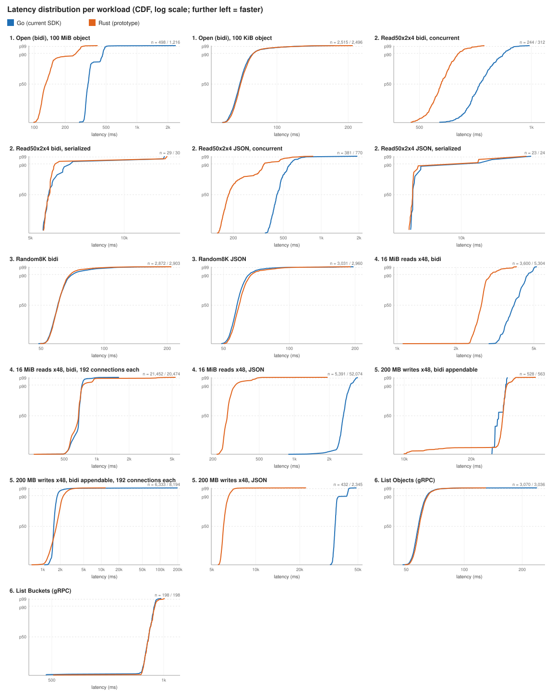
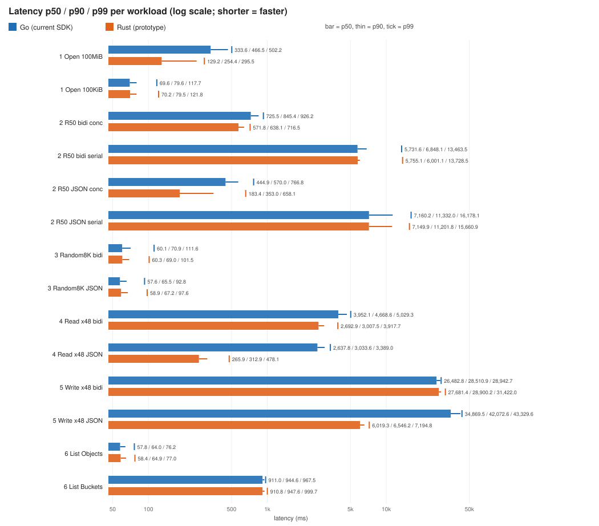
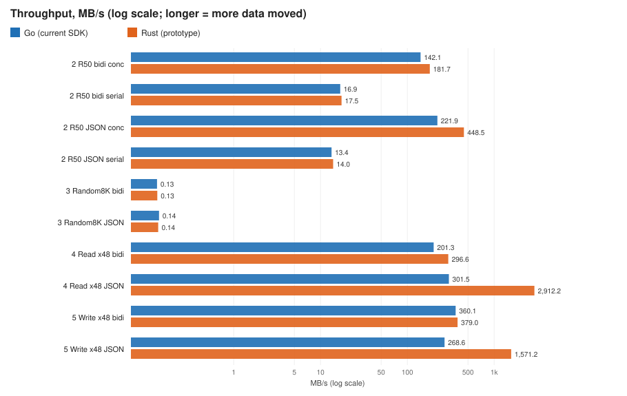
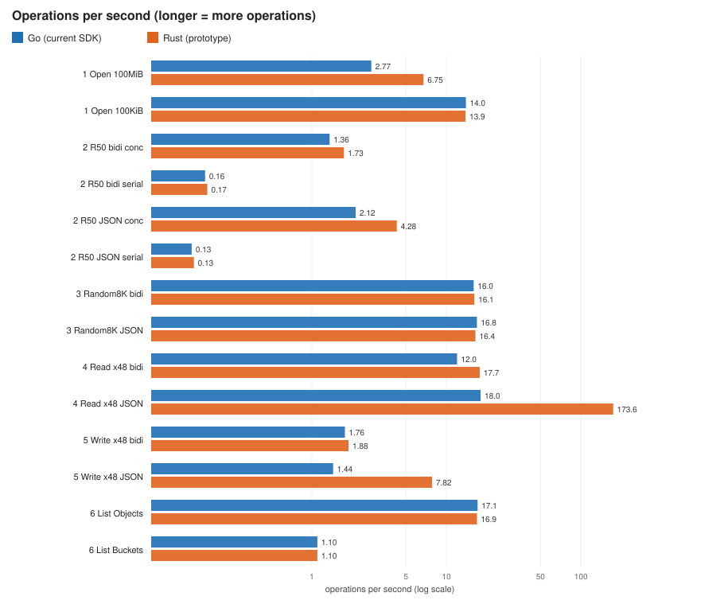
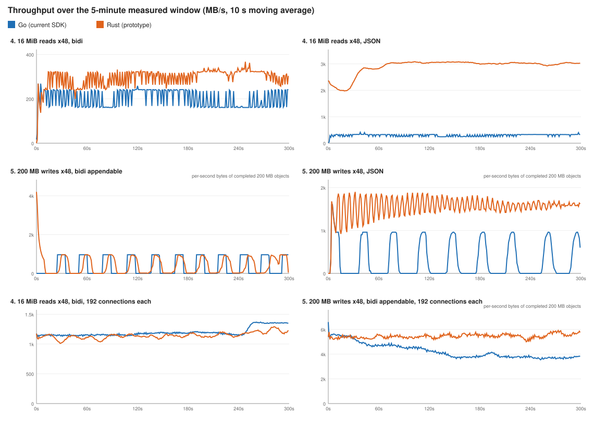
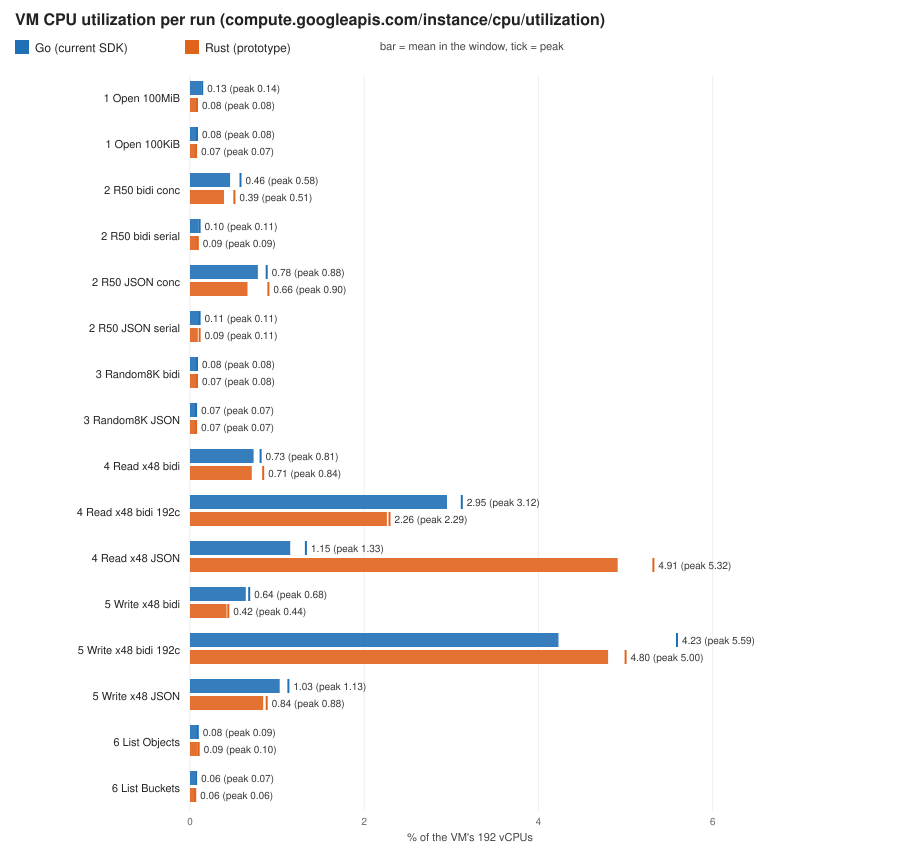
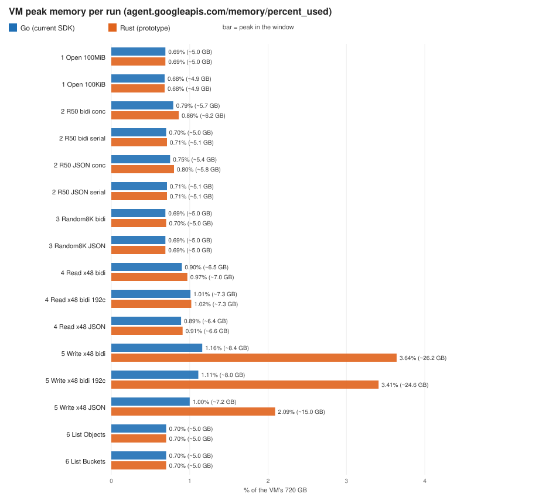
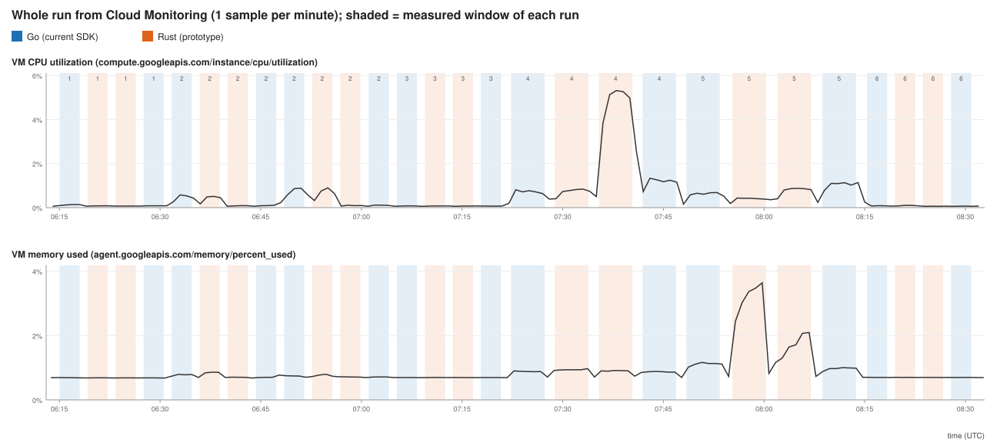

# Go PoC benchmark results: cloud.google.com/go/storage on Go vs on the Rust SDK

Run on 2026-11-05, 06:14–08:31 UTC. One pass of 28 runs, **0 errors in every run**.

This report follows the format of the Java PoC's report
([java-storage/rust-poc-benchmark/RESULTS.md](https://github.com/Dhriti07/google-cloud-java/blob/ffi-java/java-storage/rust-poc-benchmark/RESULTS.md)),
so the two can be compared side by side. Earlier Go runs are listed in [README.md](README.md#results).

## What was compared

The same binary and the same public `cloud.google.com/go/storage` calls on both engines. The only
difference is the client option `experimental.WithRustCore()`, which the benchmark adds when run
with `--engine=rust`. Without it the calls run on the Go SDK's own transports (current SDK, the
baseline: gRPC through grpc-go, JSON through net/http). With it they run on the released Rust
Storage SDK 1.20 through cgo (the prototype).

| Operation | SDK method (Go) | Bucket |
|---|---|---|
| BidiReadObject (gRPC) | `ObjectHandle.NewRangeReader` on a `NewGRPCClient` client (Go adds `WithGRPCBidiReads()`): one stream per range, because the PoC has no `MultiRangeDownloader` yet | regional |
| BidiWriteObject (gRPC, appendable) | `ObjectHandle.NewWriter` with `Writer.Append = true` and `Writer.FinalizeOnClose = true` | zonal (Rapid) |
| ReadObject (JSON) | `ObjectHandle.NewRangeReader` on a `NewClient(WithJSONReads())` client | regional |
| WriteObject (JSON) | `ObjectHandle.NewWriter` on a `NewClient` client | regional |
| ListObjects (gRPC) | `BucketHandle.Objects`, one page through `iterator.NewPager` | regional |
| ListBuckets (gRPC) | `Client.Buckets`, one page through `iterator.NewPager` | project |

Both engines use their **default settings**, which is what a user gets out of the box. Both use
CloudPath. The defaults decide the connection counts, shown in the TCP column:

- **gRPC: one connection on both engines.** The Go client defaults to one, and the PoC's Rust core
  follows the Go client's `option.WithGRPCConnectionPool` setting (default 1) instead of the Rust
  SDK's own default of one connection per vCPU. In the read runs the PoC holds a second, idle
  connection: the control-plane connection that served one metadata lookup before the window.
- **JSON: one connection for Go, one per request for Rust.** Go's HTTP client multiplexes all
  requests on one HTTP/2 connection. The Rust SDK's JSON transport is HTTP/1.1 only, so it opens one
  connection per request in flight: 48 to 51 with 48 or 50 requests at a time.

## Environment

| | |
|---|---|
| VM | `c4-standard-192` (192 vCPU, 720 GB), Ubuntu 24.04 LTS, `us-central1-f`, gVNIC, Tier_1 networking, Ops Agent |
| Buckets | a regional bucket (`us-west1`) and a Rapid zonal bucket (`us-west1-a`). The VM and the buckets are in different regions on purpose. |
| Project | not named here |
| Code | branch `go-ffi` at `a086f90aec` on github.com/krishnamd-jkp/google-cloud-go; `cloud.google.com/go/storage` at upstream `867fe707ef` plus the PoC; gRPC-Go 1.84.0; Rust `google-cloud-storage` 1.20.0 |
| Binary | `rapidbench` ([source](../cmd/rapidbench/main.go)), built with `-tags gcsrust` from `a086f90aec`, sha256 `540b8a1f3cae90c1f6c1fed25d06604a4b95fcbd9fc6c8c61e4e217bb6c278e7` |
| Runtime | Go 1.26.8; GOMAXPROCS and GOGC at their defaults (192 and 100); identical for both engines |
| Command | `REGIONAL=… ZONAL=… PROJECT=… bash storage/internal/rustcore/bench/rapid/run_all.sh` ([scripts](rapid/)), after a 45 s smoke test of every run (the 100 KiB Open was added after it) |

## How each metric is measured

| Metric | How |
|---|---|
| **Latency** p50 / p90 / p99 | Definition: the total time to complete the workload from the client application's point of view. Measured with a high-resolution timer around the outermost Go API call(s) of each operation. Only operations that end inside the measured window count. |
| **Throughput** | Definition: the rate at which data is successfully transferred. Measured as data transferred ÷ measured time, in MB/s (1 MB = 10^6 bytes) and operations per second. Writes count the bytes written inside the window. The prototype is run against the current SDK on the same workload. |
| **CPU utilization** | Definition: the percentage of processing power consumed. Measured with `compute.googleapis.com/instance/cpu/utilization`, mean (peak) over the measured window. The metric covers the whole VM, sampled once a minute: one busy vCPU is 0.52%, and the idle VM sits at about 0.06%. |
| **Peak memory** | Definition: peak memory only, because the SDKs allocate and reuse memory differently (Rust typically creates a new buffer each time). Measured as the highest `agent.googleapis.com/memory/percent_used` (state `used`) in the measured window. It covers the whole VM: 1% ≈ 7.2 GB, and the idle VM sits at about 0.69%. |

Measured window per run:
- Workloads 1, 2, 3, 6: 3 min, 1 goroutine, one operation at a time, after a 10 s warm-up.
- Workloads 4, 5: 5 min, 48 goroutines in parallel, after a 30 s warm-up.
- 60 s cooldown between runs, one run at a time on the VM. The engine that goes first alternates by
  workload.

## Results

### Overview charts

All charts compare Go (blue, current SDK) with Rust (orange, prototype). The data behind them is
in [`results/2026-11-05/`](results/2026-11-05/).

#### Latency

Definition: the total time to complete the workload from the client application's point of view.
Measured with a high-resolution timer around the outermost Go API call(s), reported as p50, p90 and
p99.

Distribution of every measured operation (CDF; further left means faster):

p50 / p90 / p99 per workload:

#### Throughput

Definition: the rate at which data is successfully transferred. Measured as total data transferred
÷ measured time, in MB/s and in operations per second. Rust (prototype) is run against Go (current
SDK) on the same workload.

Over time, for the 48-worker workloads. The write panels count completed 200 MB objects per second,
so they look spikier than the window throughput in the tables.

#### CPU utilization

Definition: the percentage of processing power consumed during the operations. Measured with
`compute.googleapis.com/instance/cpu/utilization`.

#### Peak memory

Definition: the peak memory during the run. Only the peak is measured, because Go and Rust allocate
and reuse memory differently. Measured with `agent.googleapis.com/memory/percent_used`.

#### CPU and memory across the whole run

Each shaded band is the measured window of one run: blue for Go, orange for Rust, and the number on
top is the workload.

### Detailed tables

"Go" is the current SDK; "Rust" is the prototype.

#### 1. Open: start a Bidi Read and wait for the first response (metadata), then close

`NewRangeReader(0, 0)` + `Close`. Over gRPC it requests the whole object and closes the stream after
the first response, in both engines, so that response carries data. That is why it runs on two
objects: the 100 MiB object of the Java report, and a 100 KiB object whose first response is
mostly metadata (Java's session open sends no range, so its object size doesn't matter).

| | p50 ms | p90 ms | p99 ms | ops/s | CPU % mean (peak) | Peak mem % | TCP conns |
|---|--:|--:|--:|--:|--:|--:|--:|
| Go, 100 MiB object | 333.6 | 466.5 | 502.2 | 2.77 | 0.13 (0.14) | 0.69 | 1 |
| Rust, 100 MiB object | 129.2 | 254.4 | 295.5 | 6.75 | 0.08 (0.08) | 0.69 | 2 |
| Go, 100 KiB object | 69.6 | 79.6 | 117.7 | 13.97 | 0.08 (0.08) | 0.68 | 1 |
| Rust, 100 KiB object | 70.2 | 79.5 | 121.8 | 13.87 | 0.07 (0.07) | 0.68 | 2 |

JSON: not applicable (JSON has no stream to open).

#### 2. Read50x2x4: 50 reads of 2 MiB at a 4 MiB stride from a 200 MiB object

Latency = the time to complete all 50 reads. Every read is its own range reader on both engines;
"concurrent" runs all 50 at once.

| Transport, mode | Engine | p50 ms | p90 ms | p99 ms | MB/s | CPU % mean (peak) | Peak mem % | TCP |
|---|---|--:|--:|--:|--:|--:|--:|--:|
| Bidi, concurrent | Go | 725.5 | 845.4 | 926.2 | 142.1 | 0.46 (0.58) | 0.79 | 1 |
| Bidi, concurrent | Rust | 571.8 | 638.1 | 716.5 | 181.7 | 0.39 (0.51) | 0.86 | 2 |
| Bidi, serialized | Go | 5,731.6 | 6,848.1 | 13,463.5 | 16.9 | 0.10 (0.11) | 0.70 | 1 |
| Bidi, serialized | Rust | 5,755.1 | 6,001.1 | 13,728.5 | 17.5 | 0.09 (0.09) | 0.71 | 2 |
| JSON, concurrent | Go | 444.9 | 570.0 | 766.8 | 221.9 | 0.78 (0.88) | 0.75 | 1 |
| JSON, concurrent | Rust | 183.4 | 353.0 | 658.1 | 448.5 | 0.66 (0.90) | 0.80 | 51 |
| JSON, serialized | Go | 7,160.2 | 11,332.0 | 16,178.1 | 13.4 | 0.11 (0.11) | 0.71 | 1 |
| JSON, serialized | Rust | 7,149.9 | 11,201.8 | 15,660.9 | 14.0 | 0.09 (0.11) | 0.71 | 2 |

#### 3. Random8K: random 8 KiB reads from a 100 MiB object, one at a time

| Transport | Engine | p50 ms | p90 ms | p99 ms | reads/s | CPU % mean (peak) | Peak mem % | TCP |
|---|---|--:|--:|--:|--:|--:|--:|--:|
| Bidi (one stream per read) | Go | 60.1 | 70.9 | 111.6 | 15.96 | 0.08 (0.08) | 0.69 | 1 |
| Bidi (one stream per read) | Rust | 60.3 | 69.0 | 101.5 | 16.12 | 0.07 (0.08) | 0.70 | 2 |
| JSON (one request per read) | Go | 57.6 | 65.5 | 92.8 | 16.84 | 0.07 (0.07) | 0.69 | 1 |
| JSON (one request per read) | Rust | 58.9 | 67.2 | 97.6 | 16.44 | 0.07 (0.07) | 0.69 | 2 |

Java's Bidi Random8K reads over one open session; that needs the `MultiRangeDownloader`, which the
PoC doesn't have yet.

#### 4. 16 MiB reads of a 200 MB object, 48 in parallel, 5 min

| Transport | Engine | p50 ms | p90 ms | p99 ms | MB/s (Gbps) | CPU % mean (peak) | Peak mem % | TCP | NIC rx Gbps |
|---|---|--:|--:|--:|--:|--:|--:|--:|--:|
| Bidi | Go | 3,952.1 | 4,668.6 | 5,029.3 | 201.3 (1.61) | 0.73 (0.81) | 0.90 | 1 | 1.71 |
| Bidi | Rust | 2,692.9 | 3,007.5 | 3,917.7 | 296.6 (2.37) | 0.71 (0.84) | 0.97 | 2 | 2.51 |
| JSON | Go | 2,637.8 | 3,033.6 | 3,389.0 | 301.5 (2.41) | 1.15 (1.33) | 0.89 | 1 | 2.57 |
| JSON | Rust | 265.9 | 312.9 | 478.1 | 2,912.2 (23.30) | 4.91 (5.32) | 0.91 | 49 | 24.68 |

#### 5. 200 MB writes, 48 in parallel, 5 min (each worker overwrites its own object)

| Transport | Engine | p50 ms | p90 ms | p99 ms | MB/s (Gbps) | objects/s | CPU % mean (peak) | Peak mem % | TCP | NIC tx Gbps |
|---|---|--:|--:|--:|--:|--:|--:|--:|--:|--:|
| Bidi appendable (zonal) | Go | 26,482.8 | 28,510.9 | 28,942.7 | 360.1 (2.88) | 1.76 | 0.64 (0.68) | 1.16 | 1 | 2.92 |
| Bidi appendable (zonal) | Rust | 27,681.4 | 28,900.2 | 31,422.0 | 379.0 (3.03) | 1.88 | 0.42 (0.44) | 3.64 | 1 | 2.99 |
| JSON (regional) | Go | 34,869.5 | 42,072.6 | 43,329.6 | 268.6 (2.15) | 1.44 | 1.03 (1.13) | 1.00 | 1 | 2.17 |
| JSON (regional) | Rust | 6,019.3 | 6,546.2 | 7,194.8 | 1,571.2 (12.57) | 7.82 | 0.84 (0.88) | 2.09 | 48 | 12.61 |

#### 6. List Objects and List Buckets, 100 items per page

| Operation | Engine | p50 ms | p90 ms | p99 ms | items/s | CPU % mean (peak) | Peak mem % | TCP |
|---|---|--:|--:|--:|--:|--:|--:|--:|
| List Objects (gRPC) | Go | 57.8 | 64.0 | 76.2 | 1,705.5 | 0.08 (0.09) | 0.70 | 1 |
| List Objects (gRPC) | Rust | 58.4 | 64.9 | 77.0 | 1,686.7 | 0.09 (0.10) | 0.70 | 1 |
| List Buckets (gRPC) | Go | 911.0 | 944.6 | 967.5 | 110.0 | 0.06 (0.07) | 0.70 | 1 |
| List Buckets (gRPC) | Rust | 910.8 | 947.6 | 999.7 | 110.0 | 0.06 (0.06) | 0.70 | 1 |

List over JSON is not part of the PoC comparison.

## How data moves between Go and Rust

Object bytes are copied directly, once across the boundary in each direction, through cgo: Go pins
its buffer for the call and Rust copies into or out of it. Metadata (requests, object resources and
list pages) crosses as proto3 JSON, not as protobuf.

| Path | Copy | Who allocates |
|---|---|---|
| Bidi Read (`Reader.Read` into the caller's buffer) | Rust copies the next received bytes into the caller's Go buffer (`memcpy`) | The caller; the Rust SDK, a new buffer for each received chunk |
| Read (JSON) | The same as Bidi Read, from the HTTP response chunks | The caller; the Rust SDK for each HTTP chunk |
| Bidi Appendable Write (`Writer.Write`) | Rust copies the caller's bytes into a Rust buffer, in pieces of up to 1 MiB; the Rust SDK then merges them into 2 MiB messages (a second copy) and sends them | Rust for each write call; the Rust SDK for each 2 MiB message |
| Write (JSON) | Rust copies the caller's bytes into a Rust buffer; the Rust SDK's resumable upload sends them in 16 MiB chunks, keeping each chunk until the service acknowledges it | Rust for each write call |

The Go path makes the same single copy into or out of the caller's buffer, and an upload buffers up
to 16 MiB per writer.

## What the numbers show

- **48 workers (4 and 5): the connection counts decide most of the result.**
  - Bidi, one gRPC connection on both engines: Rust moved more on reads (2.37 vs 1.61 Gbps,
    +47%) and about the same on writes (3.03 vs 2.88 Gbps). One shared connection carries all 48
    streams, so every worker is slow: a 200 MB upload takes about 27 s on both.
  - JSON: Go's single HTTP/2 connection against Rust's 48–49 HTTP/1.1 connections. Rust moved far
    more: reads 23.3 vs 2.4 Gbps, writes 12.6 vs 2.2 Gbps. This is the HTTP/2 vs HTTP/1.1 default,
    not per-connection speed.
  - CPU follows the throughput: JSON reads at 23 Gbps used 4.9% of the VM (about 9 vCPUs). Bidi
    appendable writes used less CPU on Rust (0.42% vs 0.64%) at slightly higher throughput.
- **Connections matched (the 2026-11-04 run, for context only):** with 48 gRPC connections on both
  engines, Bidi throughput was the same: reads about 9.8–9.9 Gbps and appendable writes about 37
  Gbps, with 22% less CPU per GB on Rust for reads. That run was on another VM (Debian 13,
  `us-central1-b`, default network tier) with `rustbench`, so it is context, not part of this
  result: [results/2026-11-04/REPORT.md](results/2026-11-04/REPORT.md).
- **Single operations (1, 2, 3, 6):**
  - Open on the 100 KiB object, Random8K, serialized Read50x2x4 and both lists are the same within a
    few percent.
  - Open on the 100 MiB object is faster on Rust (129 vs 334 ms p50): the first response carries
    data, and Go takes longer to receive it.
  - Read50x2x4 concurrent: over Bidi Rust is faster on one connection each (182 vs 142 MB/s, p50
    572 vs 726 ms); over JSON Rust is 2× faster with 51 connections against Go's 1.
- **Peak memory: Rust is higher wherever data moves in bulk.**
  - Bidi appendable writes: 3.64% vs 1.16% of the VM, about 26 vs 8 GB (process peak RSS 21.5 vs
    2.8 GiB). The Rust SDK queues up to 100 messages of 2 MiB per upload stream before it slows the
    writer down (`MAX_QUEUED_REQUESTS` in its `bidi_write/connector.rs`), so each 200 MB upload can
    sit in memory almost whole, and glibc keeps freed memory in per-thread pools.
  - JSON writes: 2.09% vs 1.00% (process peak RSS 10.1 vs 2.0 GiB), not investigated yet.
  - Bidi reads: 0.97% vs 0.90%. Single operations stay near the idle level (about 0.69%).

## Caveats

1. **One pass.** Each number comes from a single run, with no spread across rounds. Compared with
   the 45 s smoke test:
   - The JSON and write results repeat: JSON reads 1,989 (smoke) vs 2,912 MB/s for Rust and 255 vs
     302 MB/s for Go; JSON writes 1,439 vs 1,571 MB/s for Rust and 285 vs 269 MB/s for Go.
   - **Bidi reads at 48 workers did not:** the smoke test had Go at 214 and Rust at 179 MB/s, the
     reverse of the 5-minute result. One connection carrying 48 streams is sensitive to network
     conditions, so treat that gap as uncertain.
2. **Defaults differ by design.** Connection counts are each engine's default (the TCP column), so
   4 and 5 compare what users get, not equal connection counts. The Java report's Rust engine kept
   the Rust SDK's default (up to one connection per vCPU); the Go PoC's Rust core follows the Go
   client's setting. Compare the two reports' 48-worker rows with the TCP column in mind.
3. **The VM metrics are coarse for light workloads.** They sample the whole 192-vCPU, 720 GB VM once a
   minute. Single-operation workloads (1, 2, 3, 6) use about 0.1% CPU and stay near the idle memory
   level, so small differences there are within noise.
4. **Cross-region.** The VM is in `us-central1` and the buckets are in `us-west1`. Absolute latency
   includes that distance; the comparison between engines holds, but absolute numbers would be
   lower in the same region.
5. **PoC limits on the Rust side.** No `MultiRangeDownloader`: every Bidi read is one stream per
   range, on both engines, where the Java report reads over one session. The Rust SDK's JSON
   transport is HTTP/1.1 only. Metadata crosses the boundary as JSON, which costs some CPU on list
   pages.
6. **One status check overlapped a run.** A status check over SSH at 06:25:10 UTC fell inside the
   measured window of Open on the 100 KiB object on Rust (06:23:22–06:26:22). It lasted a few
   seconds.
7. **Fixes from earlier runs that apply to both engines here:** writes overwrite each worker's own
   object (keeping every object filled the project's Rapid storage quota), every operation has a
   timeout, and Go's built-in gRPC client metrics are off, because only the Go path would pay for
   them.
